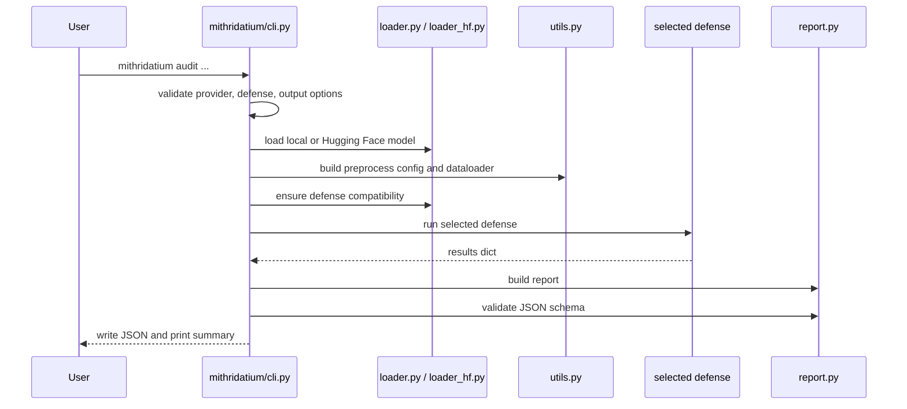

# CLI Flow

The main user entry point is:

```bash
mithridatium audit --model models/resnet18_poison.pth --data cifar10 --defense mmbd --out reports/mmbd.json
```

The command is implemented in `mithridatium/cli.py`.

## Basic CLI Commands

```bash
mithridatium --version
mithridatium --help
mithridatium audit --help
mithridatium defenses
mithridatium agent --help
```

## Flow



## Supported Providers

| Provider | CLI options | Notes |
| --- | --- | --- |
| `torchvision` | `--model`, `--arch` | Loads a local `.pt` or `.pth` checkpoint. |
| `huggingface` | `--provider huggingface`, `--hf-model-id` | Loads an image-classification repo through `AutoModelForImageClassification`. |

## Supported Defenses

Use `mithridatium defenses` to list supported defenses.

```bash
mithridatium defenses
```

The current defense set is `aeva`, `freeeagle`, `mmbd`, and `strip`.

## Exit Codes

| Code | Meaning |
| --- | --- |
| 64 | Invalid CLI usage, such as an unsupported defense or incompatible defense/model pair |
| 66 | Local model path missing or not a file |
| 73 | Output file already exists and `--force` was not supplied |
| 74 | Load, execution, report validation, or I/O failure |

## Output Behavior

By default, `mithridatium audit` writes JSON to `reports/report.json`. Use `--out -` to write JSON to stdout, or `--force` to overwrite an existing report file.

```bash
mithridatium audit \
  --model models/resnet18_clean.pth \
  --defense freeeagle \
  --data cifar10 \
  --out - \
  | python -m json.tool
```

When running from inside the package folder, adjust paths back to the repository root:

```bash
cd mithridatium
mithridatium audit \
  --model ../models/resnet18_clean.pth \
  --defense freeeagle \
  --data cifar10 \
  --out ../reports/freeeagle.json \
  --force
```

## Agent Command

`mithridatium agent` sends a plain-English request to an LLM agent that runs Mithridatium through the MCP server. By default it runs the supervisor, which routes the request to the audit, detect, and repair agents. `--agent` / `-a` picks one specialist instead (`supervisor`, `audit`, `detect`, or `repair`).

```bash
mithridatium agent "Check models/resnet18_poison.pth and repair it if it's poisoned"
mithridatium agent --agent audit "Run MMBD on models/resnet18_poison.pth"
```

It needs the `[agent]` extra, and `OPENAI_API_KEY` for OpenAI models. The supervisor never repairs a model unless the request asks for it. Setup, routing rules, and output paths are in [MCP server and agents](mcp.md#supervisor-agent).

| Option | What it does |
| --- | --- |
| `--agent` / `-a` | Agent to run: `supervisor` (default), `audit`, `detect`, or `repair`. |
| `--llm` | Chat model, e.g. `gpt-4o` or `ollama:llama3.1`. Defaults to `$MITHRIDATIUM_LLM`, then `gpt-4o-mini`. See [Choosing the chat model](mcp.md#choosing-the-chat-model). |
| `--report` / `-r` | Save a JSON summary of the run (supervisor only). See [Saving a run summary](mcp.md#saving-a-run-summary). |
| `--force` / `-f` | Overwrite an existing `--report` file. |
| `--quiet` / `-q` | Print only the final reply, not the progress line for each agent and tool call. |
| `--no-memory` | Run without memory: nothing is recalled or saved. |
| `--forget` | Delete the memory store and exit without running an agent. |

The agents remember past runs in `memory/memory.json`. What is stored and how it is recalled is in [Memory](mcp.md#memory).

## Troubleshooting

- `model path not found or not a file`: check the current working directory and use `../` paths if you are inside `mithridatium/`.
- `output file already exists`: add `--force` or choose a new `--out` path.
- `unsupported --defense`: run `mithridatium defenses` and choose one of the listed defenses.
- Hugging Face load failures usually mean the repo is not compatible with `AutoModelForImageClassification` or its preprocessing is not supported by the current wrapper.

## Notes for Contributors

- Adding a defense, method, or CLI verb? Follow the [add-a-capability checklist](../handoff/add-a-capability.md).

- Keep `DEFENSES` in `mithridatium/cli.py` aligned with defense docs.
- When adding CLI flags, update the relevant defense page and [sample commands](../testing/sample-commands.md).
- The CLI validates generated reports against `reports/report_schema.json`; update the schema when adding new required report fields.
