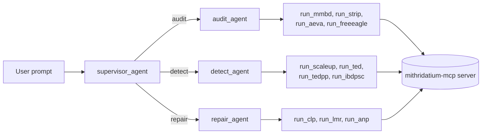

# MCP Server and Agents

Mithridatium can expose the same audits as MCP tools, and a small agent can call those tools for one checkpoint. The tools do not reimplement the defenses. Each one calls `audit()` in `mithridatium/cli.py`.

The server lives in `mithridatium/mcp/`. The console script is `mithridatium-mcp`, which runs `mithridatium.mcp:main`.

## Install

The server and agent are an optional extra. Use Python 3.10 or newer.

```bash
python -m venv .venv
source .venv/bin/activate
pip install -e ".[agent]"
```

The bundled agent calls `init_chat_model("gpt-4o-mini")`. That needs the OpenAI provider package and an API key in the same shell:

```bash
pip install langchain-openai
export OPENAI_API_KEY="sk-..."
```

Run the server and the agent on a machine where PyTorch imports successfully.

## Tools


| Tool            | Defense   |
| --------------- | --------- |
| `run_mmbd`      | MMBD      |
| `run_strip`     | STRIP     |
| `run_aeva`      | AEVA      |
| `run_freeeagle` | FreeEagle |


### Detect
| Tool          | Method   |
| ------------- | -------- |
| `run_scaleup` | SCALE-UP |
| `run_ted`     | TED      |
| `run_tedpp`   | TED++    |
| `run_ibdpsc`  | IBD-PSC  |

### Repair 
| Tool       | Method |
| ---------- | ------ |
| `run_clp`  | CLP    |
| `run_lmr`  | LMR    |
| `run_anp`  | ANP    |


Each tool takes the same general inputs as the CLI: `model`, `data`, `arch`, `provider`, and `hf_model_id`. Defense-specific options use the same names as the CLI flags, with underscores instead of hyphens (`freeeagle_anomaly_threshold`, `strip_mad_scale`, and so on).

Defaults match a local CIFAR-10 ResNet-18 checkpoint at `models/resnet18.pth`. Pass the checkpoint path you actually want to audit.

## Reports

A tool writes the report before it returns `{"report_path": ..., "report": ...}` to the caller:

```text
reports/<checkpoint-stem>_<defense>.json
```

`models/resnet18_poison.pth` audited with MMBD becomes `reports/resnet18_poison_mmbd.json`. The path is relative to the server process working directory. The agent sets that directory to the repository root. An existing file with the same name is overwritten.

The audit's own progress logs are not printed on the MCP connection. The saved JSON file and the tool result are the record.

## Run the Server

For an MCP client on the same machine:

```bash
mithridatium-mcp
```

On a cluster, shell startup functions are sometimes exported as `BASH_FUNC_*` environment variables. The MCP client warns on those values and can refuse to start the server. The bundled agent drops names that start with `BASH_FUNC_` before it launches the server. A hand-written client config should do the same.

## Run the Agent

`mithridatium agent` runs the supervisor, which routes the request to the audit, detect, and repair agents. `--agent` / `-a` runs one specialist instead (`supervisor`, `audit`, `detect`, or `repair`). With no prompt, each agent uses its built-in default prompt.

```bash
# Default: the supervisor picks the agents
mithridatium agent "check models/resnet18_poison.pth and repair it if it's poisoned"

# One specialist directly
mithridatium agent --agent audit "Run STRIP and MMBD on models/resnet18_clean.pth"
mithridatium agent --agent detect "Run TED on models/resnet18_poison.pth"
mithridatium agent -a repair "Run LMR on models/resnet18_poison.pth with target class 0 and prune ratio 0.05"
```

The `python -m` entry points below still work. Each agent connects to the local server, asks the model to call the requested defenses, and prints the model's last message:

```bash
python -m mithridatium.mcp.audit_agent
```

That command audits `models/resnet18_poison.pth`. With no defense named, the system prompt tells the model to run MMBD only. To ask for something else, pass a prompt:

```bash
python -m mithridatium.mcp.audit_agent "Run STRIP and MMBD on models/resnet18_clean.pth"
```

The detect and repair agents work the same way:

```bash
python -m mithridatium.mcp.detect_agent "Run TED on models/resnet18_poison.pth"
python -m mithridatium.mcp.detect_agent "Run TED++ on models/resnet18_poison.pth"
python -m mithridatium.mcp.repair_agent "Run LMR on models/resnet18_poison.pth with target class 0 and prune ratio 0.05"
python -m mithridatium.mcp.repair_agent "Run ANP on models/resnet18_poison.pth"
```

With no prompt, the detect agent runs SCALE-UP and the repair agent runs CLP on `models/resnet18_poison.pth`. Each agent only receives its own tools. The repair agent supports `run_clp`, `run_lmr`, and `run_anp`. The detect agent's tools are `run_scaleup`, `run_ted`, `run_tedpp` and `run_ibdpsc`, and their options use the CLI flag names with underscores (`ibdpsc_scale`, `ibdpsc_num_models`, and so on). From Python, call `audit_agent()`, `detect_agent()` or `repair_agent()` with the prompt string.

The printed reply is a short verdict summary. The full report is the JSON file under `reports/`.

## Supervisor Agent

The supervisor is the recommended entry point for the agent workflow. You give it one plain-English request, and it decides which specialist agents to call and in what order. You don't need to know whether a method lives in audit, detect, or repair.

It lives in `mithridatium/mcp/supervisor_agent.py`. Its only tools are the three specialist agents, each wrapped as a LangChain tool: `audit`, `detect`, and `repair`. It never calls the `run_*` MCP tools itself. Each specialist keeps its own system prompt and its own tool list, and the supervisor sends it a plain-English request with the model path and any method names or settings the user gave.



### Run it

`mithridatium agent` runs the supervisor by default:

```bash
mithridatium agent "Check models/resnet18_poison.pth and repair it if it's poisoned"
```

The module entry point and the Python function do the same thing:

```bash
python -m mithridatium.mcp.supervisor_agent "Audit models/resnet18_poison.pth"
```

```python
import asyncio
from mithridatium.mcp.supervisor_agent import supervisor_agent

print(asyncio.run(supervisor_agent("Audit models/resnet18_poison.pth")))
```

With no prompt, the supervisor runs audit and detect on `models/resnet18_poison.pth`, then runs a repair only if at least one result flagged a backdoor. The install and API key setup are the same as for the other agents (see [Install](#install)).

### How it routes requests

| Prompt | What runs |
| ------ | --------- |
| `Audit models/resnet18_poison.pth` | `audit` only. The audit agent runs MMBD, since no defense was named. |
| `Run TED on models/resnet18_poison.pth` | `detect` only. |
| `Repair models/resnet18_poison.pth with CLP` | `repair` only. |
| `Check models/resnet18_poison.pth and repair it if it's poisoned` | `audit`, then `repair` only if the audit flagged the model. If nothing was flagged, the supervisor says so and stops. |

A few more rules from the system prompt:

- If the user just says "check" or "test" a model without naming anything, it runs audit, then detect.
- After a repair, it audits the repaired checkpoint that repair returned, not the original.
- If an audit result includes a `suspected_target`, it passes that along as the target class for an LMR repair.
- If a specialist says it is missing a value (for example LMR's prune ratio), the supervisor passes that back to the user instead of making one up.

### Repair only runs on request

Repair writes a new checkpoint, so it should never happen as a side effect. The supervisor only calls `repair` when the prompt asks for it:

- **Asked outright** ("Repair ... with CLP"): it runs repair directly.
- **Conditional** ("... and repair it if it's poisoned"): it runs repair only if at least one audit or detection result flagged the model.
- **Not mentioned**: it doesn't run repair, even if the model is flagged.

A repaired checkpoint is not proven clean. The follow-up audit is a check, not a guarantee.

### Where the output goes

The supervisor prints a short summary: each agent it ran, that agent's verdict, and where the reports and any repaired checkpoint were saved. It only reports what the tools returned and doesn't invent metrics.

The files themselves are written by the MCP tools, relative to the repository root:

| Step | Output |
| ---- | ------ |
| Audit | `reports/<checkpoint-stem>_<defense>.json` |
| Detect | `reports/<checkpoint-stem>_<method>.json` |
| Repair | checkpoint at `models/<checkpoint-stem>_<method>_repaired.pth`, report at `reports/<checkpoint-stem>_<method>_repair.json` |

For example, a CLP repair of `models/resnet18_poison.pth` saves `models/resnet18_poison_clp_repaired.pth` and `reports/resnet18_poison_clp_repair.json`. The follow-up audit of that checkpoint then writes `reports/resnet18_poison_clp_repaired_mmbd.json`. Existing files with the same name are overwritten.

### Tests

`tests/unit/test_supervisor_agent.py` checks the routing for the four sample prompts with a scripted fake chat model and mocked specialist agents, so it runs without an API key or GPU. It skips if the `[agent]` extra isn't installed.

## Contributor Notes

- When you add a new specialist agent, wrap it as a `@tool` in `mithridatium/mcp/supervisor_agent.py`, add it to the tool list passed to `create_agent`, and describe it in `SUPERVISOR_SYSTEM_PROMPT` (what it handles and when to call it). The tool's docstring is what the model sees, so name the methods it covers. Add a routing case for it to `tests/unit/test_supervisor_agent.py`.
- A new MCP tool for an existing specialist doesn't need a supervisor change. The specialist picks it up from the server, but update the method list in the wrapper's docstring so the supervisor knows to route there.

- Register new tools on the shared `mcp` object in `mithridatium/mcp/__init__.py`, and import the new module from `main()` before `mcp.run`. Importing a tool module at the top of `__init__.py` cycles, because the tool module imports `mcp` from the package.
- Keep `@mcp.tool(run_in_thread=False)`. The audit builds a PyTorch `DataLoader` with worker processes. Starting those workers from a FastMCP background thread deadlocks. Forking them from the server process can also deadlock, so `main()` sets `MITHRIDATIUM_NUM_WORKERS=0` and the loaders in `utils.py` run in-process.
- Stay on FastMCP 3.x. `langchain-mcp-adapters` 0.3.2 requires `mcp` 1.x, and FastMCP 4 requires `mcp` 2.x.


## Related Docs

- [CLI flow](cli-flow.md)
- [Reporting pipeline](reporting-pipeline.md)
- [Testing overview](../testing/overview.md)
- [Known issues](../handoff/known-issues.md)

